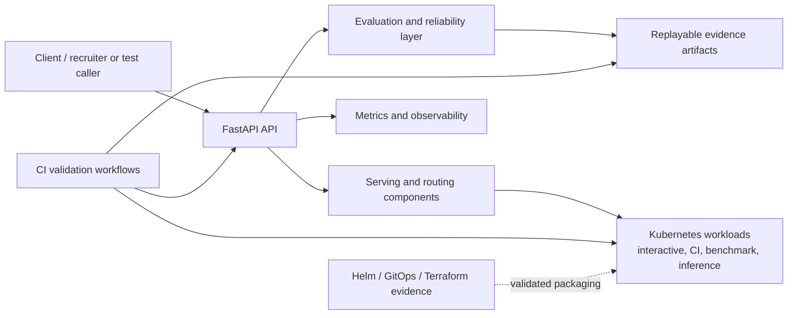

# AgentTrust IQ architecture

The client-facing surface is the FastAPI application in `backend/app`. Its evaluation and reliability modules implement deterministic groundedness, citation, refusal, prompt-injection, PII, unsafe-action, routing, and audit behavior. Serving and routing modules select the supported runtime path and expose the OpenAI-compatible inference surface.

The Kubernetes layer contains the verified interactive, CI, benchmark, inference, scheduling, autoscaling, resilience, recovery, and resource-pressure workloads. Metrics and structured JSONL artifacts capture runtime and evaluation evidence. GitHub Actions workflows build the images, create disposable validation environments where applicable, execute bounded checks, and upload evidence.

Helm, GitOps, and Terraform appear here as repository packaging and CI-validated infrastructure evidence. No production cluster, managed-cloud operation, or real AMD GPU execution is claimed. AMD/ROCm hardware validation is implemented, but real GPU execution remains blocked pending access to qualifying AMD hardware.
