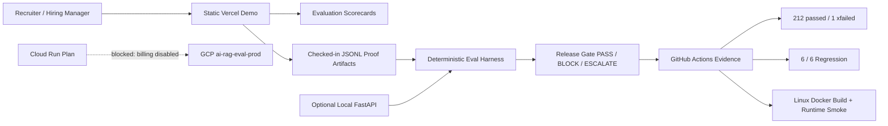

# Gate 14.1 Zero-Cost Recruiter Demo

Status: zero-cost demo path prepared. No Google Cloud billing, APIs, resources, secrets, IAM bindings, Cloud Build jobs, or Cloud Run deployments were created.

Baseline commit: `cc3076dca67ff244282be77a1282c348d9f65c9e`

## Decision

The GCP project `ai-rag-eval-prod` is not used for live deployment because project billing is disabled and the linked billing account is closed. AgentTrust IQ remains recruiter-demo-ready through the existing static Vercel frontend, checked-in proof artifacts, deterministic local/mock evaluation, and verified GitHub Actions evidence.

## Demo URL

- Static recruiter demo: `https://ai-agent-reliability-platform-rtcd.vercel.app/`
- Static Command Center: `https://ai-agent-reliability-platform-rtcd.vercel.app/agenttrust-iq-command-center.html`
- Verification status: static demo path only. The public site does not claim live paid model inference or a public FastAPI backend.

## What The Demo Can Show Without Paid Infrastructure

- Evaluation scorecards from deterministic fixture artifacts.
- Citation precision using checked-in JSONL evaluation records.
- Hallucination detection using negative-control fixture records.
- Prompt-injection defense using deterministic safety cases and release-gate checks.
- PII safeguards using redaction and leakage checks from local/test artifacts.
- Release-gate decisions through `scripts/check_eval_thresholds.py`.
- JSONL proof artifacts from `docs/artifacts/eval_runs/hiring_eval.jsonl`.
- Container/runtime proof through GitHub Actions logs, not a live public backend.

## Evidence Links

Verified on `main` at `cc3076dca67ff244282be77a1282c348d9f65c9e`:

- CI Smoke Test: `https://github.com/Electricpaper77/ai-rag-eval-platform/actions/runs/38174175922`
- AgentTrust Focused Validation: `https://github.com/Electricpaper77/ai-rag-eval-platform/actions/runs/38174175866`
- Recruiter Evidence Pack: `https://github.com/Electricpaper77/ai-rag-eval-platform/actions/runs/38174175896`
- GPU Benchmark: `https://github.com/Electricpaper77/ai-rag-eval-platform/actions/runs/38174175982`
- AgentTrust Container Runtime Smoke: `https://github.com/Electricpaper77/ai-rag-eval-platform/actions/runs/38174175910`
- AgentTrust Production CI: `https://github.com/Electricpaper77/ai-rag-eval-platform/actions/runs/38174175889`
- Production CI evidence artifact: `https://github.com/Electricpaper77/ai-rag-eval-platform/actions/runs/38174175889/artifacts/11715242014`
- Container runtime smoke artifact: `https://github.com/Electricpaper77/ai-rag-eval-platform/actions/runs/38174175910/artifacts/11715043452`

Verified metrics:

- Full pytest: `212 passed, 1 xfailed`
- Regression harness: `6/6`
- Release gate: `PASS`
- Production CI Docker image: `sha256:19e18e2cac382c733dc5c5fdff10a093b2e0cf4aedc934c727cb34a906ff403c`
- Container runtime smoke Docker image: `sha256:4234f8b08a6ce4e6e5a3bb8ad29dab771e06e84c901770cb065799e0de5be446`

Scope caveats:

- The six-case metrics are deterministic fixture results, not customer-production telemetry.
- `latency_p95_ms` is local deterministic evaluator runtime, not model, network, RAG, Docker runtime, or public API latency.
- `cost_per_request_usd` is an estimated mock/no-vendor API label from the deterministic artifact, not a cloud invoice.
- GPU benchmark mock/server-unavailable rows are schema and readiness evidence only, not real GPU throughput.

## Static Frontend Audit

- `vercel.json` serves `frontend/index.html`, `frontend/agenttrust-iq-command-center.html`, `frontend/styles.css`, `frontend/assets/*`, and checked-in `docs/*` proof artifacts.
- `frontend/index.html` explicitly discloses that the browser demo is static and not connected to a backend API.
- `frontend/agenttrust-iq-command-center.html` falls back to deterministic client-side data when `/demo/agenttrust-iq` is unavailable.
- `frontend/streamlit_app.py` now supports `AGENTTRUST_API_BASE` so localhost is the default for local review, not a production assumption.

## Interview-Ready Architecture



## 90-Second Walkthrough

1. "AgentTrust IQ is an LLM and AI-agent reliability platform. The public demo is intentionally static and zero-cost, while the backend is validated through local tests and GitHub Actions."
2. "Start with the scorecards: the canonical deterministic run has 6 of 6 controlled cases passing, with citation precision, hallucination detection, refusal accuracy, and release-gate outputs tied to JSONL artifacts."
3. "Open the JSONL proof artifact. Each result is inspectable and reproducible, which is the difference between a polished demo and an evaluation system."
4. "Show the static scenario switcher: a good RAG citation case, a citation failure case, and prompt-injection defense. These are demo fixtures, not live model calls."
5. "Then open GitHub Actions: Production CI ran dependency checks, compile, regression, release gate, full pytest, Docker build, and evidence upload. Container Runtime Smoke validated the real FastAPI image on Linux."
6. "Cloud Run is prepared but not deployed because billing is disabled. That is intentional: I am preserving cost control and not claiming production traffic until the infrastructure is actually authorized and smoke-tested."

## Reproduce Locally

```bash
python -m pip check
python -m compileall -q app backend gpu_platform scripts tests
python scripts/run_regression_tests.py
python scripts/check_eval_thresholds.py --artifact runs/agenttrust_regression_eval.jsonl
python -m pytest -q --basetemp .pytest_tmp
```

Optional local backend:

```bash
python -m uvicorn backend.app.main:app --host 127.0.0.1 --port 8000
```

Optional Streamlit review:

```bash
AGENTTRUST_API_BASE=http://127.0.0.1:8000 streamlit run frontend/streamlit_app.py
```

## Remaining Limitations

- No public paid FastAPI backend is running.
- No Cloud Run service exists from this gate.
- No production model-provider inference is claimed.
- Static demo evidence is public and safe; sensitive runtime traces, secrets, and raw private artifacts are not exposed.
- A live Cloud Run deployment still requires separate billing, IAM, Secret Manager, and smoke-test approval.
